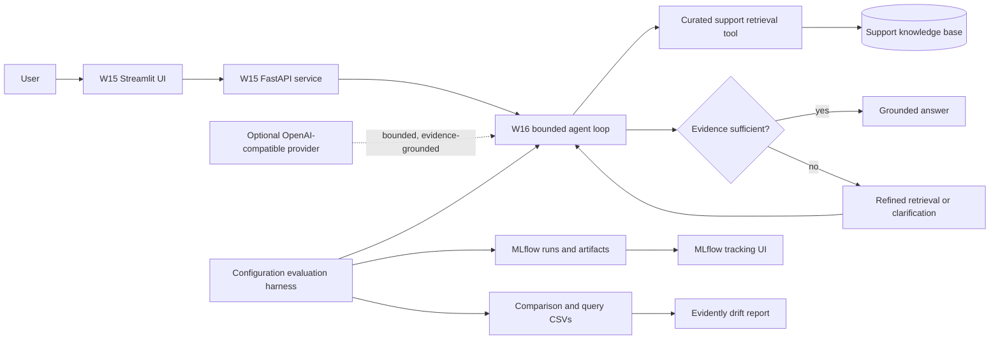

# Part B Architecture

The serving path uses a deterministic local knowledge base by default. The optional provider is disabled unless explicitly configured with environment settings and a key. The evaluation harness runs the same labeled query suite against multiple bounded retrieval configurations, logs results to MLflow, exports comparison artifacts, and compares evaluation telemetry with Evidently.
